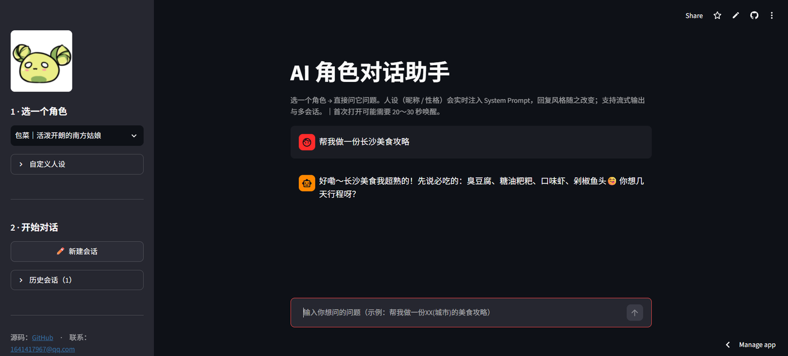
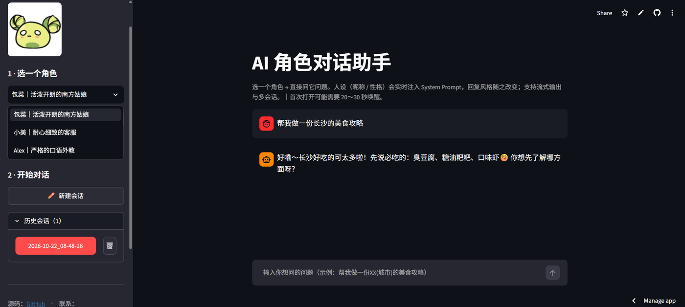

# AI 角色对话助手（可配置人设）

基于 DeepSeek 大模型的角色对话应用：自定义「人设」（昵称 + 性格）后开聊，支持多会话隔离、会话持久化与流式输出。

## 功能

- **人设配置**：昵称、性格自由填写，实时注入 System Prompt，切换会话后自动还原
- **流式对话**：调用 DeepSeek Chat API（SSE 流式），回复逐字显示
- **多会话管理**：每个会话独立 JSON 文件，支持新建、加载、删除，列表按时间倒序
- **会话持久化**：以 `YYYY-MM-DD_HH-MM-SS` 命名，重启后仍可恢复

## 技术栈

Python 3.10+ · Streamlit · OpenAI SDK（DeepSeek 兼容接口）· JSON 持久化 · Prompt 工程

## 快速开始

```bash
git clone https://github.com/<your-name>/ai-persona-chat.git
cd ai-persona-chat
pip install -r requirements.txt

# Windows PowerShell
$env:DEEPSEEK_API_KEY="sk-xxxxxxxx"
# macOS / Linux
export DEEPSEEK_API_KEY="sk-xxxxxxxx"

streamlit run app.py
```

浏览器打开 `http://localhost:8501` 即可。

## 目录结构

```
.
├── app.py                 # 主程序：UI、会话管理、模型调用
├── requirements.txt
├── .gitignore
├── resource/
│   └── logo.png           # 侧边栏 Logo
└── session/               # 运行时生成，已在 .gitignore 中忽略
```

## 关键设计

1. **人设注入**：System Prompt 用 `%s` 占位，分别填入昵称与性格；用户修改后下一次请求即生效。
2. **会话隔离**：一个会话一个 JSON 文件，结构为 `{current_time, nick_name, nature, messages}`，避免会话串味。
3. **流式渲染**：`stream=True` 逐块累加 `delta.content`，用占位组件实时刷新，避免整页重绘。

## 已知局限 / TODO

- [ ] 会话存储从本地 JSON 迁移到 MySQL（支持多用户、并发、检索）
- [ ] 增加 API 超时、限流与重试，失败时给出友好提示
- [ ] 补充 pytest 单元测试（System Prompt 构建、会话读写）
- [ ] 支持导出会话为 Markdown / PDF

## 截图

| 主界面 | 侧边栏人设配置 |
| --- | --- |
|  |  |

> 截图放在 `docs/` 目录，README 里用相对路径引用。

## License

MIT
